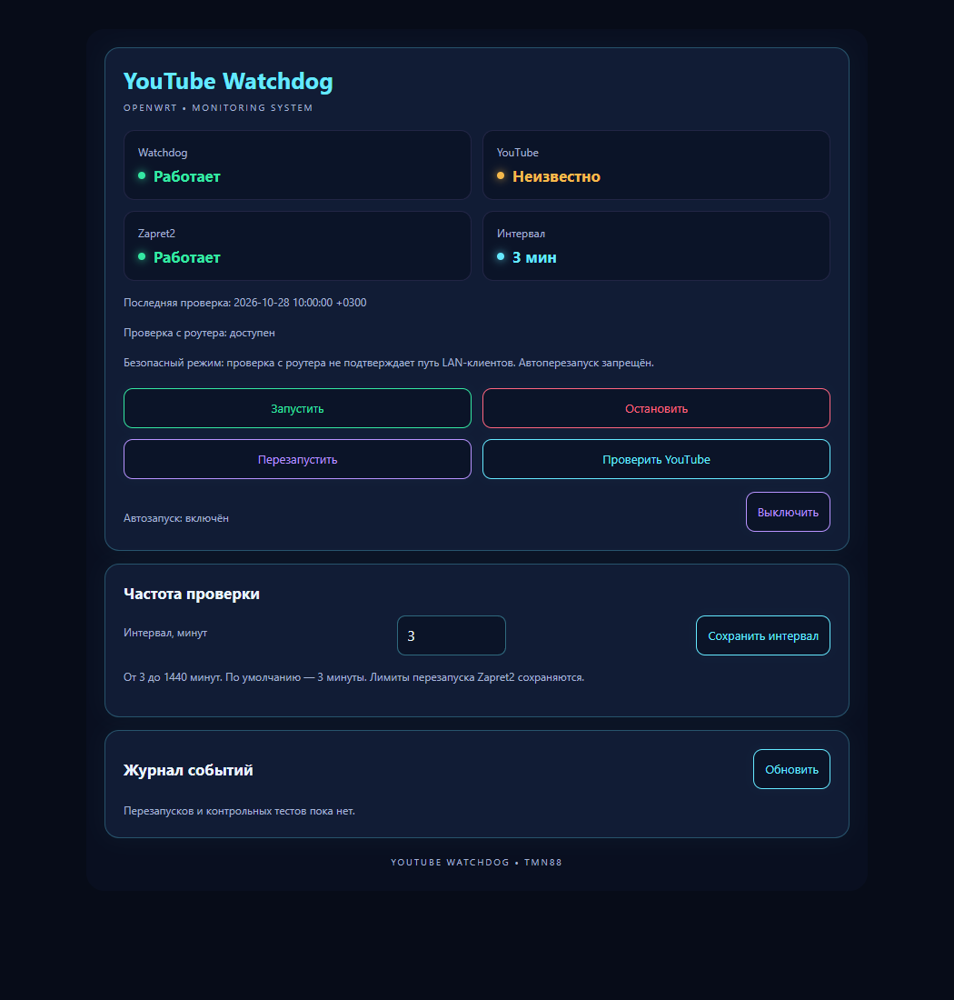

# YouTube Watchdog • TMN88

Отдельная служба OpenWrt **24.10.x (opkg)** / **25.12.x (apk)** с русской страницей **LuCI → Службы → YouTube Watchdog**. POSIX shell, BusyBox, procd, UCI, curl; без Python на роутере, Blockcheck2, подбора стратегий и перезагрузок.

> По умолчанию установлен **безопасный режим**: выполняются проверки с роутера, а клиентский статус YouTube остаётся **UNKNOWN / «Неизвестно»**. Автоматические перезапуски запрещены. Для них необходим отдельный диагностический LAN-клиент, настроенный согласно [CLIENT.md](CLIENT.md). Router-local OUTPUT не доказывает работу LAN/FORWARD.

## Установка

Одна команда:

```sh
wget -O /tmp/youtube-watchdog-install.sh https://raw.githubusercontent.com/TMN88/youtube-watchdog/main/install.sh && sh /tmp/youtube-watchdog-install.sh
```

Выполнять от root на OpenWrt с LuCI. Установщик проверяет версию, определяет apk/opkg, устанавливает только недостающие `curl ca-bundle flock rpcd luci-base` (и `coreutils-timeout`, если нет команды timeout), скачивает комплект **1.1.0** по закреплённому commit, сверяет SHA256SUMS, проверяет shell и JSON, размещает файлы и регистрирует RPC. Затем включает автозапуск и запускает Watchdog. Если LuCI уже открыта, обновите вкладку. Отдельная Custom Commands не требуется.

При повторной установке существующий `/etc/config/youtube-watchdog` сохраняется целиком. Файлы предыдущей версии сохраняются во временной папке до окончания установки; ошибка применения вызывает откат файлов и прежнего состояния службы. Зависимости не удаляются при откате. SHA256SUMS защищает от неполной/несогласованной загрузки; это не независимая цифровая подпись.

Роутер должен иметь верные дату/время и рабочее хранилище сертификатов. TLS-проверка не отключается ни в одном режиме.

### Исправление установщика 1.0.1

На сборках OpenWrt без команды `timeout` установщик автоматически добавляет `coreutils-timeout` через штатный opkg/apk. Если BusyBox или другой установленный пакет уже предоставляет команду, дополнительный пакет не требуется. Доступность `timeout` повторно проверяется после установки зависимостей, до размещения и запуска службы. Ошибка установки пакета не отключает ограничения времени и не позволяет продолжить установку. Состав службы и закреплённый комплект файлов 1.0.0 не изменены.

### Исправление установщика 1.0.2

Установщик освобождает блокировку проверки перед запуском procd-службы. В версиях до 1.0.2 первый фоновый цикл мог пропускаться, пока установщик ещё держал блокировку, поэтому время первой проверки появлялось только после следующего интервала или ручного `youtube-watchdog check`. Переустановка для уже работающей службы не обязательна: ручная проверка безопасна и не перезапускает Zapret2. Если локальная проверка прошла, `local_probe` показывает HEALTHY, но в безопасном режиме клиентский `youtube` остаётся UNKNOWN.

### Настройка частоты — 1.1.0

В LuCI → Службы → YouTube Watchdog появилась карточка **«Частота проверки»**. Укажите целое число от **3 до 1440 минут** и нажмите **«Сохранить интервал»**. По умолчанию — 3 минуты. Настройка сохраняется в собственный UCI-параметр Watchdog и подхватывается работающим демоном без перезапуска: ожидание следующей проверки пересчитывается в течение 5 секунд. Выполняющийся сетевой тест не прерывается. При увеличении интервала ожидание продлевается, при уменьшении уже истёкшего интервала проверка запускается после обработки изменения. Повторное сохранение того же значения не записывает UCI заново. Неверный тип, дробь и значения вне диапазона отклоняются сервером; RPC может изменять только этот параметр.

Изменение интервала не меняет лимиты восстановления Zapret2. Поле ввода не сбрасывается при автоматическом обновлении страницы. Строка **«Проверка с роутера»** отдельно показывает локальную диагностику; верхний клиентский статус YouTube в безопасном режиме остаётся UNKNOWN. Доступность HTTPS с роутера не доказывает воспроизведение видео у клиентов.

## Работа

* Первое измерение — при запуске procd, последующие — через 180 секунд **после завершения предыдущего цикла**. Пока DNS/контрольный HTTPS не готовы, восстановление запрещено. Фактическое время между началами проверок включает длительность измерения.
* Отдельно проверяется DNS четырёх доменов, внешний контроль `https://example.com/` и три ресурса YouTube: `https://www.youtube.com/generate_204`, `https://i.ytimg.com/generate_204`, `https://youtubei.googleapis.com/`.
* Только IPv4, TCP, HTTPS с проверкой сертификата и имени узла. curl не читает пользовательский curlrc и обходит переменные HTTP-прокси. Подключение — до 4 секунд, запрос — до 8 секунд, DNS — до 6 секунд; запросы последовательные.
* Для доступности нужны минимум два из трёх ресурсов. HTTP 403/404/405 от YouTube означает завершённый TLS/HTTP-обмен, а не сетевой обрыв; API не требует ключей. Ответы 5xx, 429 и ошибки сертификатов дают неопределённость, а не основание для перезапуска. Для контрольного сайта 403/404 не считаются успехом.
* «Доступен» означает доступность нескольких HTTPS-ресурсов с диагностического клиента. Это **не гарантия воспроизведения**, работы googlevideo CDN, авторизации или каждого устройства LAN.
* В режиме SSH подтверждённый отказ — минимум две ошибки транспорта YouTube при рабочем контроле и DNS. Через 10 секунд проводится повторная полная проверка. Общесетевой/DNS/TLS-сбой или недостоверный ответ запрещает перезапуск.
* Перед восстановлением проверяются существование и исполняемость `/etc/init.d/zapret2` и успешное `running`. Только штатная команда `restart`, ограниченная 40 секундами. Остановленный/отсутствующий Zapret2 не запускается.
* Попытки восстановления: минимум 900 секунд между ними, максимум три за скользящие 3600 секунд. Учёт — монотонное время `/proc/uptime`; неуспешная команда тоже расходует лимит.
* После попытки — пауза 15 секунд и контрольная проверка. Гистерезис: новые попытки разрешаются только после **двух последовательных успешных фоновых проверок**. Если восстановления нет, служба продолжает мониторинг без постоянных рестартов. При достижении лимита мониторинг также продолжается.
* Runtime хранится в `/tmp`, события — в кольцевом системном журнале. Перезапуск Watchdog сохраняет лимиты и гистерезис; перезагрузка роутера очищает RAM и лимиты. Kernel flock защищает фоновые процессы и проверки от параллельного выполнения. Конфигурация и код Zapret2, firewall, маршруты, DNS и другие обходы не изменяются.

## Команды

```sh
/etc/init.d/youtube-watchdog start
/etc/init.d/youtube-watchdog stop
/etc/init.d/youtube-watchdog restart
/etc/init.d/youtube-watchdog enable
/etc/init.d/youtube-watchdog disable

youtube-watchdog check    # однократная проверка, НИКОГДА не вызывает restart
youtube-watchdog status   # JSON: служба, YouTube, Zapret2, автозапуск, время, причина
youtube-watchdog logs     # JSON: последние 20 событий, новые сверху
logread -e youtube-watchdog-event
```

`check` может занять до двух минут в режиме SSH. При занятой блокировке CLI возвращает ошибку. Кнопка LuCI ставит такую же проверку в фон, а статус обновляется каждые 5 секунд. При остановке Watchdog Zapret2 не останавливается. «Остановить» и «Выключить автозапуск» — независимые действия.

Компактный журнал содержит только два типа событий: попытка штатного перезапуска с причиной и результатом команды; результат контрольного теста после неё (восстановлен / не восстановлен / неизвестно). Обычные успешные проверки и технический вывод curl не попадают в журнал. После очистки logread или перезагрузки история может быть пустой. Операции установки выводятся только в терминал.

## UCI

```uci
config watchdog 'main'
    option mode 'safe'
    option interval '180'
    option client_host ''
    option client_user 'watchdog'
    option client_confirmed '0'
```

В UCI интервал хранится в секундах: диапазон 180–86400; некорректное значение заменяется на 180. В LuCI настройка задаётся целыми минутами и применяется автоматически. При ручном редактировании UCI можно выполнить `/etc/init.d/youtube-watchdog restart`, чтобы применить изменение сразу. Предыдущий результат после изменения UCI или истечения срока годности отображается как UNKNOWN. Причины представлены стабильными кодами в `status`.

## Удаление

```sh
sh /usr/libexec/youtube-watchdog-uninstall
```

Либо скачать опубликованный скрипт:

```sh
wget -O /tmp/youtube-watchdog-uninstall.sh https://raw.githubusercontent.com/TMN88/youtube-watchdog/main/uninstall.sh && sh /tmp/youtube-watchdog-uninstall.sh
```

Удаляются только собственные файлы, UCI и runtime-состояние. Zapret2 не удаляется и не останавливается. Общие зависимости остаются. Вручную размещённые SSH-ключи и known_hosts в `/etc/youtube-watchdog` сохраняются. Старые записи кольцевого logread исчезнут естественным образом.

## Интерфейс

Реальный JavaScript view LuCI, собственный RPC объект `youtube-watchdog`, ACL только на девять фиксированных методов. Нет доступа к произвольным файлам, командам или произвольной записи UCI через браузер; метод настройки может менять только интервал Watchdog и проверяет тип и диапазон значения. Непривилегированным сессиям без write-доступа управление недоступно. Все данные журнала выводятся текстом, без вставки HTML. Стили ограничены префиксом `youtube-watchdog-`, системные шрифты, без внешних ресурсов.



[Мобильный вид](preview-mobile.png) · [автономный просмотр с подставными данными](preview.html). Предпросмотр использует тот же `files/overview.js` и имитирует RPC; он не подключается к роутеру.

## Проверки и границы подтверждения

См. [VALIDATION.md](VALIDATION.md). Локальные тесты с mock DNS/HTTPS, пакетным менеджером и службой не являются испытанием настоящих пакетов opkg/apk, procd/rpcd или совместимости с каждой темой LuCI. На действующих роутерах сбои не создавались. Репозиторий `TMN88/zapret2-youtube-autotune` не изменяется.

Референс структуры установщика: [TMN88/podkop-vpn-failover-owrt](https://github.com/TMN88/podkop-vpn-failover-owrt). Watchdog не зависит от Podkop и не устанавливает его.
